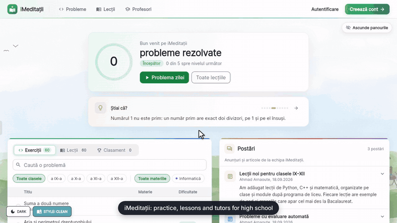
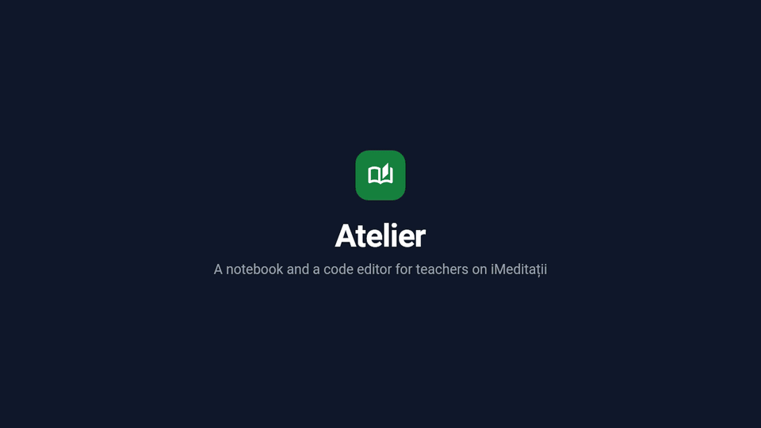

# iMeditații

> **Live site:** [https://ahmad1827.github.io/](https://ahmad1827.github.io/)

A learning platform for Romanian high-school students: auto-graded problems in computer science and maths, lessons that follow the school curriculum, and 1-to-1 tutoring with verified teachers. Teachers get a workspace where they write by hand, run code, and send both to their students.

<p align="center">
  
</p>

---

## What's inside

### For students

* **Problems with automatic grading.** 60 computer science problems (grades IX–XI) and 61 maths problems (grades IX–XII), grouped by chapter and difficulty. C++ solutions are compiled and run against tests; maths answers are checked on the spot, and each maths problem has a worked solution.
* **An editor in the browser.** Syntax colours, auto-indent, sample tests, and a result panel showing which tests passed.
* **Lessons.** Python, C++ and maths for grades IX–XII, organised by chapter, with reading progress.
* **Tutors.** Browse verified teachers by subject, read reviews, and message them directly.
* **Progress.** Solved problems, levels and badges on your dashboard and profile.

### For teachers: the Atelier

<p align="center">
  
</p>

* **Handwritten pages.** A full sheet you write on like a notebook: pen, marker, eraser, lines and shapes, squared or lined paper, zoom, undo.
* **A code IDE.** C++ and Python with line numbers, snippets, input, and real runs with time and memory.
* **Text pages.** Headings, lists, checklists, callouts and code blocks for lesson plans and worksheets.
* **Send to students.** Pick the students, add a note, send. They find it under "Materiale primite" in their dashboard.
* **See their work.** Students write on their own layer over a handwritten page, or edit their own copy of a code file. The teacher can open either and see what they did.

### Also

* **Chat, whiteboard and video calls** between a student and a teacher.
* **Payments** for sessions through Stripe.
* **Light and dark themes.**

---

## Demo videos

* [Full demo (site tour + Atelier)](docs/media/imeditatii-demo.mp4)
* [Site tour](docs/media/site-tour.mp4)
* [Atelier](docs/media/atelier-demo.mp4)

The site tour is a recording of the live site. The Atelier demo is rendered from the app's own screens with sample data.

---

## Tech stack

* **App:** Flutter (web first, with mobile targets)
* **Data and auth:** Firebase Firestore, Firebase Auth, Cloud Storage
* **Code execution:** Judge0
* **Calls:** Agora RTC
* **Payments:** Stripe, through Firebase Cloud Functions
* **Routing:** `go_router`

---

## Getting started

1. Clone the repository:
   ```bash
   git clone https://github.com/Ahmad1827/iMeditatii.git
   cd iMeditatii
   ```

2. Install dependencies:
   ```bash
   flutter pub get
   ```

3. Set up Firebase (requires the FlutterFire CLI):
   ```bash
   flutterfire configure
   ```

4. Create a `.env` file in the project root (do not commit it):
   ```env
   AGORA_APP_ID=your_agora_app_id
   STRIPE_PUBLISHABLE_KEY=your_stripe_publishable_key
   ```

5. Run the app:
   ```bash
   flutter run -d chrome
   ```

6. Run the tests:
   ```bash
   flutter test
   ```
   They cover the Atelier end to end (editors, autosave, sending, the student's side) against an in-memory database, so no Firebase project is needed.

---

## Contributing

Bug fixes and suggestions are welcome.

1. Fork the repository.
2. Create a branch (`git checkout -b feature/my-change`).
3. Commit your changes.
4. Push the branch and open a pull request.

---

## Copyright and usage

You are welcome to read the code and to contribute, but **this codebase is not open source for commercial reuse, redistribution or white-labelling.**

* ✅ Fork the repo to submit pull requests here.
* ✅ Read the code to learn how things are built.
* ❌ Do not clone the app, rebrand it, and sell, host or publish it as your own.
* ❌ Do not reuse the UI, artwork or branding in your own commercial projects.

**All rights reserved.** If you would like to use parts of this project commercially, get in touch to discuss licensing.
